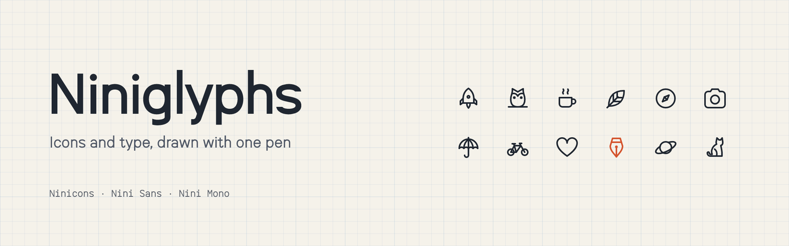

<picture>
  <source media="(prefers-color-scheme: dark)" srcset="org-dark.png">
  
</picture>

Icons and type drawn with one pen, on one 32-unit grid, by Sayantan Roy.

| | | |
|---|---|---|
| [**Ninicons**](https://github.com/niniglyphs/ninicons) | Nearly 3,000 SVG icons in seven styles, with packages for React, Vue, Svelte, Solid, Angular, the web, Tailwind and an icon font. | MIT |
| [**Nini Sans**](https://github.com/niniglyphs/nini-sans) | A neo-grotesk in five weights and their italics, whose stems match the icon strokes. Latin, Vietnamese, Greek and Cyrillic. | OFL |
| [**Nini Mono**](https://github.com/niniglyphs/nini-mono) | The same letters in an 18-unit cell for code and terminals, with box drawing and Powerline symbols. | OFL |

An icon set at 1 em sits on the Nini Sans baseline with no nudging, and every weight of the type has an icon
style at the same stroke.

```bash
npm i @ninicons/react
```

Missing an icon? [Request one](https://github.com/niniglyphs/ninicons/issues/new?template=request-an-icon.yml).

**[niniglyphs.com](https://niniglyphs.com)**
